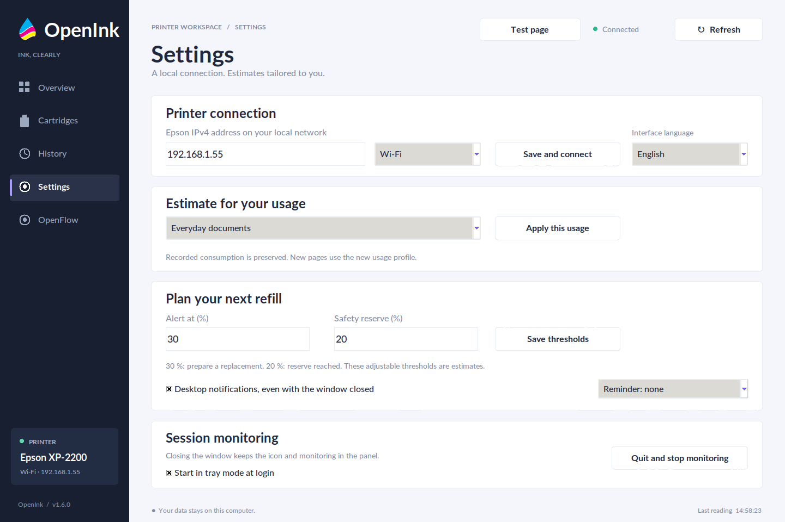
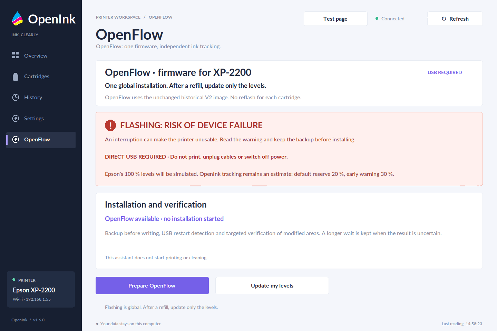

<p align="center"></p>

<h1 align="center">OpenInk · Linux</h1>

<p align="center"><a href="README.md">Français</a> · <strong>English</strong> · <a href="README.es.md">Español</a></p>

<p align="center">Estimated ink tracking, Ubuntu notifications and OpenFlow firmware for Epson XP-2200.</p>

<p align="center">
  
  
  
  
</p>

**OpenInk installs OpenFlow on an Epson XP-2200, then tracks estimated remaining ink and sends Ubuntu notifications.**

The original firmware can reject third-party compatible cartridges and prevent
printing. **Flashing OpenFlow over USB** changes that behaviour globally: on
the tested XP-2200 IU05P2, it allowed printing with compatible cartridges that
had previously been rejected or reported as unrecognised. It does not rewrite
their chips or make every cartridge model usable. Chip-free cartridges and
all third-party models have not been validated.

After OpenFlow is installed, Epson's 100 % readings are simulated. OpenInk
therefore maintains **independent per-colour estimates** based on page counters
and declared starting levels. Reserve alerts help plan refills, but do not
physically measure ink or guarantee that the nozzles will stay primed.
There is no need to reflash for each cartridge.


*English interface screenshots use example values and contain no personal data.*

> **Target: Epson XP-2200 / IU05P2 only.** Flashing can make the printer
> unusable. Ink estimates are not physical measurements and cannot guarantee
> protection against running dry.

## Features

| Feature | Behaviour |
| --- | --- |
| Overview | Connection, status, colour/monochrome page counters and activity |
| Cartridges | Reported diagnostics and independent estimates for each colour |
| Profiles | Standard 604, 604XL or a custom page yield |
| Alerts | Early warning at 30 %, reserve at 20 %, adjustable thresholds |
| Background tracking | Panel icon, login startup and native Ubuntu notifications |
| History | Local SQLite storage and JSON export |
| Test page | One A4 PDF with the logo, CMYK fills, gradients, text and fine lines |
| OpenFlow | Explicit USB assistant, backup, integrity checks and risk acceptance |
| Languages | French, English and Spanish, with a saved preference |

This repository contains the **Linux version only**: sources, tests, artwork
and build scripts. Personal printer backups, recovery executables and
experimental firmware prototypes are excluded. The bundled USB library keeps
its original provenance and licence.

## Requirements

- Ubuntu with a graphical session; package target **x86_64 / amd64**.
- Python **3.10+**, Tkinter, Pillow and PyGObject/GLib.
- libusb, CUPS client, systemd, xdg-utils and XRandR.
- An Epson XP-2200 for hardware features. Monitoring supports USB or a local
  network; flashing requires a direct USB cable.
- A configured Epson CUPS queue for printing the test page.

The package declares its dependencies. For source-based use:

```bash
sudo apt update
sudo apt install python3 python3-tk python3-pil python3-gi gir1.2-glib-2.0 \
  libusb-1.0-0 cups-client systemd xdg-utils x11-xserver-utils
```

## Installation

### Ready-to-install Ubuntu package

Download `openink_1.6.0_amd64.deb` and `SHA256SUMS` from
[Releases](https://github.com/Chrisnox-209/OpenInk/releases/tag/v1.6.0) into the
same folder. Close the previous window, open a terminal in that folder and run:

```bash
sha256sum --ignore-missing -c SHA256SUMS
sudo apt install ./openink_1.6.0_amd64.deb
openink
```

Continue only if the package checksum reports `OK`. `--ignore-missing` allows
verification without downloading the source archive. Installing or updating
OpenInk does not start a flash. Existing data is preserved; a printer already
running OpenFlow/V2 does not need to be reflashed.

### Build from source

```bash
git clone https://github.com/Chrisnox-209/OpenInk.git
cd OpenInk
sudo apt install dpkg-dev desktop-file-utils
python3 linux/build_deb.py
sudo apt install ./linux/dist/openink_1.6.0_amd64.deb
openink
```

Generated files stay in `linux/dist/`, outside Git. The `.deb` has an adjacent
SHA-256 file. Installation adds the OpenInk launcher, session startup and a USB
access rule limited to the normal XP-2200 (`04b8:11b1`). Daily use is **without sudo**.

To run directly from the repository:

```bash
./linux/Lancer-OpenInk.sh
./linux/Lancer-OpenInk.sh --host 192.168.1.100 --transport network
./linux/Lancer-OpenInk.sh --transport usb
```

Replace the example IP address with your printer's address. Installing the
package is recommended for USB permissions and desktop integration.
`python3 linux/installer_raccourci.py` creates a user launcher only; it does
not install dependencies or USB rules.

## Languages

French remains the default repository README. The application supports
**Français**, **English**, **Español** and the system default in
**Settings > Interface language**. The selection is saved and the window
updates immediately. The panel menu, notifications and test page follow it.
Page counters, cartridge profiles and historical data are preserved.

```bash
openink --lang fr
openink --lang en
openink --lang es
```



## Panel icon and automatic startup

At login, OpenInk starts **without a window**, with the panel icon and the
monitoring agent. Click the icon or choose **Open OpenInk** to show the window.
Closing the window keeps tracking and notifications active. The icon menu
shows status and counters, refreshes monitoring and offers **Quit and stop monitoring**.
Stopping monitoring does not interrupt a firmware worker.

Configure startup in **Settings > Start in tray mode at login**. The icon uses
StatusNotifierItem; your panel must support application indicators. If the
panel does not display it, monitoring can continue and `openink` still opens
the window. A powered-off computer or closed session cannot deliver notifications.
OpenInk does not control printer LEDs.

```bash
openink --background
openink --stop-agent
openink --help
```

## Set up ink tracking

1. Select the correct connection in **Settings**.
2. Initialise each colour in **Cartridges** with its profile and an honest
   estimate. A partially used cartridge should not be declared full.
3. After an actual refill or replacement, update only the affected colours.
   A reset without adding ink preserves estimated consumption.
4. Enable notifications and adjust the thresholds to your usage.

Estimates use page counters and selected yields. Photos, heavy coverage,
cleaning cycles and varying compatible-cartridge volumes can consume more ink.
Alerts are **non-blocking**. A counter rollback invalidates tracking and asks
you to review the starting levels. Refill or replace early if print quality drops.

## OpenFlow and cartridge “reset”

OpenFlow uses the unchanged historical V2 image. It modifies the behaviour of
**all four colours globally**, not one selected chip. Cartridge selections in
the assistant initialise local tracking; they do not rewrite cartridge chips.

- Epson's 100 % readings under OpenFlow are simulated; use OpenInk estimates.
- Successful tests with some compatibles do not establish universal support
  or prove that chips can be removed.
- Diagnostics interpret reported states; they cannot measure actual ink or
  conclusively identify a physically defective chip.
- No maintenance-pad reset, Wi-Fi flash or arbitrary firmware image is offered.

After installation, update the local estimates when refilling. Reflashing for
each cartridge is unnecessary.

## Firmware warning and installation



The assistant requires explicit installation confirmation, acceptance of flash
risks and confirmation of a **direct USB connection**. It checks model,
identity, supported image/version, availability and print queues, then makes
a complete backup before writing. Unknown images and MFP-IPL are refused.

Flashing risks malfunction or permanent failure. Success is not guaranteed;
the acceptance notice limits liability to the extent permitted by law.
Acceptance does not make the operation risk-free.

**Keep USB and power connected. Do not print, suspend the computer, update or
uninstall OpenInk during the operation.** Closing the window does not cancel it.

After an exact acknowledgement and a confirmed stable normal USB restart,
the targeted check reads all modified sectors and expected boot elements.
An uncertain response or restart retains the cautious wait of up to fifteen
minutes and full-verification conditions. No automatic reflash follows an
interruption. A full read-only audit remains optional after a successful
targeted check. The complete backup before writing is still required.

See the [technical V2 scope](docs/PERIMETRE_V2.md) for exact hashes and limits.

## Colour test page

Choose **Test page**, select your Epson queue, then **View page** or **Print one page**.
The PDF follows the selected language. Unverified destinations require an
explicit confirmation. Disabled queues are identified and an available queue
is suggested when possible.

A fresh status read precedes submission. Exactly one colour A4 copy is sent,
without duplex printing. No existing job is removed. Flashing in progress,
an unready printer or a busy queue prevents submission. CUPS acceptance does
not alone prove physical output. This visual chart does not replace Epson's
nozzle check. The [English PDF](commun/inkora/assets/test-page.en.pdf) is included.

## Local data and removal

| Data | Default location |
| --- | --- |
| History and ink tracking | `~/.local/share/inkora/inkora.sqlite3` |
| Firmware logs and backups | `~/.local/share/inkora/firmware/` |
| Local agent communication | User XDG runtime directory |

XDG environment overrides are respected. The internal Python module and data
directory remain `inkora` for compatibility. Data is not automatically sent
to a third party. Real serial numbers, exports and personal backups must stay
out of Git.

```bash
openink --stop-agent
sudo apt remove openink
```

Removal preserves local data and does not restore printer firmware. Keep your
firmware backup somewhere safe.

## Development and validation

```bash
python3 -m unittest discover -s linux/tests -v
python3 linux/tests/check_i18n.py
python3 linux/tests/check_interface.py
dbus-run-session -- python3 linux/tests/check_tray.py
python3 linux/build_deb.py
python3 linux/build_linux.py
```

Offline tests cover tracking, reserves, migration, notifications, panel IPC,
dialogs, simulated CUPS submission and firmware-controller boundaries.
They do not replace physical testing of every printer. Artwork, language
catalogues and PDFs are included. Regenerating them requires build-only tools:

```bash
sudo apt install python3-reportlab poppler-utils fonts-lato
python3 linux/build_brand_assets.py
```

Firmware assets are pinned and included; historical reverse-engineering tools
needed to reconstruct the firmware are outside this repository. The hardware
image is unchanged in this software update.

See [validation notes](docs/OPENINK_1.6.md), [architecture](docs/ARCHITECTURE.md)
and [contribution conventions](CONTRIBUTING.md).

## Troubleshooting

| Symptom | Check |
| --- | --- |
| Printer offline | Address, power and selected transport |
| USB access denied | Package installation, session permissions and another process holding the port; reconnect only outside a flash |
| No notification | Monitoring, Ubuntu notification/Do Not Disturb settings and active session |
| Unknown level | Initialise the colour with a cautious estimate |
| Epson reports 100 % | Use OpenInk's estimates rather than simulated firmware readings |
| Test page refused | Selected queue, fresh ready status and no firmware operation |
| Interrupted firmware operation | Preserve logs/backups and use verification; do not blindly reflash |

## Notices

OpenInk is an independent project with no Epson affiliation. Names and marks
belong to their owners. The USB library's MIT licence and provenance are
preserved in [THIRD_PARTY_NOTICES.md](THIRD_PARTY_NOTICES.md). That licence does
not reassign rights to the included manufacturer firmware.
