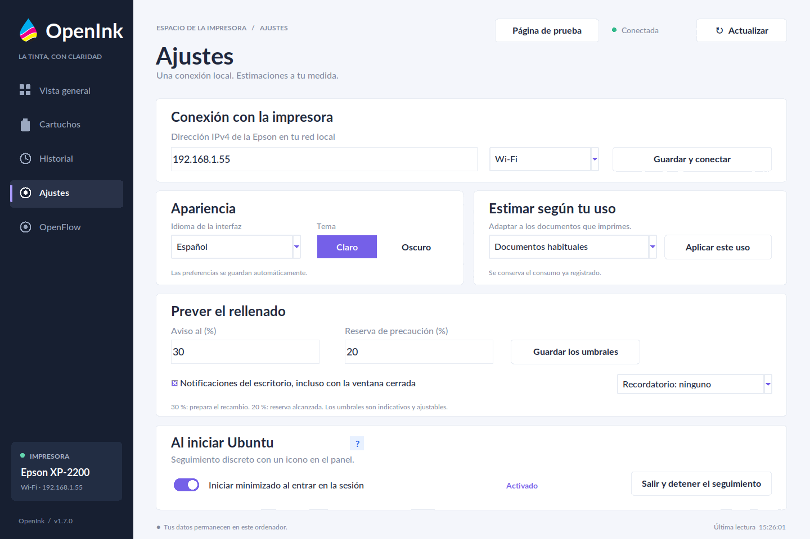
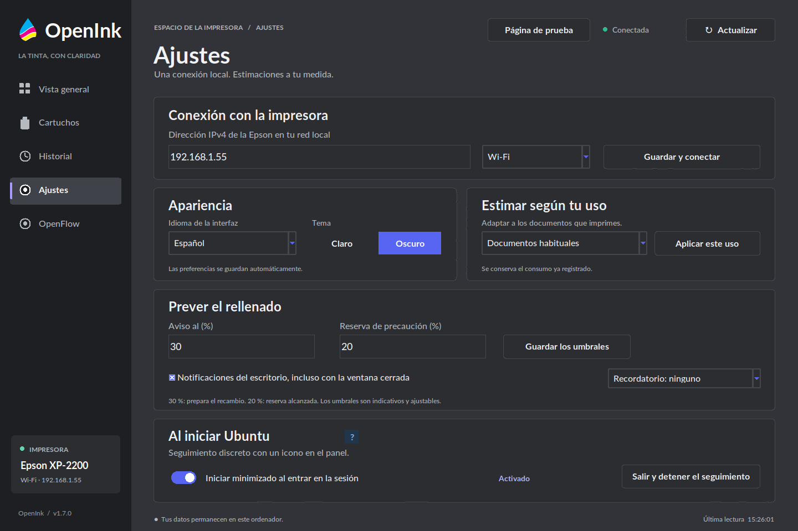
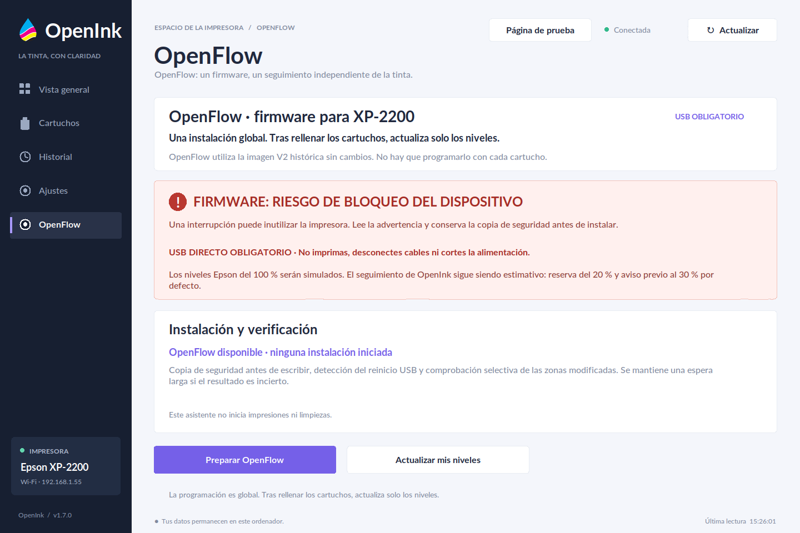

<p align="center"></p>

<h1 align="center">OpenInk · Linux</h1>

<p align="center"><a href="README.md">Français</a> · <a href="README.en.md">English</a> · <strong>Español</strong></p>

<p align="center">Seguimiento indicativo de tinta, notificaciones Ubuntu y firmware OpenFlow para Epson XP-2200.</p>

<p align="center">
  
  
  
  
</p>

**OpenInk instala OpenFlow en una Epson XP-2200 y después estima la tinta
restante y envía notificaciones Ubuntu.**

El firmware original puede rechazar cartuchos compatibles de terceros e
impedir la impresión. **Programar OpenFlow mediante USB** modifica ese
comportamiento de forma global: en la XP-2200 IU05P2 probada, permitió imprimir
con cartuchos compatibles antes rechazados o señalados como no reconocidos.
No reescribe sus chips ni hace utilizable cualquier referencia. No se han
validado los cartuchos sin chip ni todos los modelos de terceros.

Con OpenFlow instalado, los niveles Epson del 100 % son simulados. Por ello,
OpenInk mantiene una **estimación independiente por color**, basada en los
contadores de páginas y el nivel inicial declarado. Los avisos de reserva
ayudan a prever el rellenado, pero no miden físicamente la tinta ni garantizan
que los inyectores no se queden sin ella. No hay que volver a programar el
firmware con cada cartucho.


*Capturas de la interfaz española con valores de ejemplo, sin datos personales.*

> **Solo Epson XP-2200 / IU05P2.** La programación del firmware puede
> inutilizar la impresora. Los niveles son estimaciones, no mediciones físicas,
> y no garantizan la protección frente al agotamiento de tinta.

## Funciones

| Función | Comportamiento |
| --- | --- |
| Vista general | Conexión, estado, contadores de páginas en color y monocromas, actividad |
| Cartuchos | Diagnóstico notificado y estimaciones independientes por color |
| Perfiles | 604 estándar, 604XL o rendimiento personalizado |
| Avisos | Aviso previo al 30 %, reserva al 20 %, umbrales ajustables |
| Seguimiento en segundo plano | Icono del panel, inicio de sesión y notificaciones Ubuntu |
| Historial | Base SQLite local y exportación JSON |
| Página de prueba | Un PDF A4 con logotipo, colores CMYK, degradados, texto y líneas finas |
| OpenFlow | Asistente USB, copia previa, comprobación de integridad y aceptación de riesgos |
| Idiomas | Francés, inglés y español, con preferencia guardada |

Este repositorio contiene **solo la versión Linux**: fuentes, pruebas,
recursos gráficos y scripts de construcción. No incluye copias personales
de impresoras, ejecutables de recuperación ni prototipos experimentales de
firmware. La biblioteca USB conserva su procedencia y licencia originales.

## Requisitos

- Ubuntu con sesión gráfica; paquete destinado a **x86_64 / amd64**.
- Python **3.10 o posterior**, Tkinter, Pillow y PyGObject/GLib.
- libusb, cliente CUPS, systemd, xdg-utils y XRandR.
- Epson XP-2200 para las funciones de hardware. El seguimiento admite USB o
  red local; la programación requiere un cable USB directo.
- Una cola CUPS Epson configurada para la página de prueba.

El paquete declara sus dependencias. Para usar el código fuente:

```bash
sudo apt update
sudo apt install python3 python3-tk python3-pil python3-gi gir1.2-glib-2.0 \
  libusb-1.0-0 cups-client systemd xdg-utils x11-xserver-utils
```

## Instalación

### Paquete Ubuntu listo para instalar

Descarga `openink_1.7.0_amd64.deb` y `SHA256SUMS` desde
[Releases](https://github.com/Chrisnox-209/OpenInk/releases/tag/v1.7.0) en la
misma carpeta. Cierra la ventana anterior, abre un terminal en esa carpeta y ejecuta:

```bash
sha256sum --ignore-missing -c SHA256SUMS
sudo apt install ./openink_1.7.0_amd64.deb
openink
```

Continúa solo si la comprobación del paquete indica `OK`. `--ignore-missing`
permite verificarlo sin descargar el archivo de fuentes. Instalar o actualizar
OpenInk no inicia ninguna programación de firmware. Los datos existentes se
conservan; una impresora que ya tenga OpenFlow/V2 no necesita volver a programarse.

### Construir desde las fuentes

```bash
git clone https://github.com/Chrisnox-209/OpenInk.git
cd OpenInk
sudo apt install dpkg-dev desktop-file-utils
python3 linux/build_deb.py
sudo apt install ./linux/dist/openink_1.7.0_amd64.deb
openink
```

Los archivos generados quedan en `linux/dist/`, fuera de Git. La huella SHA-256
del `.deb` se escribe a su lado. La instalación añade el lanzador OpenInk,
el inicio de sesión y una regla de acceso USB limitada a la XP-2200 normal
(`04b8:11b1`). El uso diario se realiza **sin sudo**.

Para ejecutar desde el repositorio:

```bash
./linux/Lancer-OpenInk.sh
./linux/Lancer-OpenInk.sh --host 192.168.1.100 --transport network
./linux/Lancer-OpenInk.sh --transport usb
```

Sustituye la dirección de ejemplo por la de tu impresora. Se recomienda
instalar el paquete para los permisos USB y la integración con Ubuntu.
`python3 linux/installer_raccourci.py` solo crea un lanzador de usuario;
no instala dependencias ni reglas USB.

## Idiomas

El francés sigue siendo el README principal del repositorio. En
**Ajustes > Apariencia > Idioma de la interfaz** puedes elegir **Français**, **English**,
**Español** o el idioma del sistema. La preferencia se guarda y la ventana
se actualiza al instante. El menú del panel, las notificaciones y la página
de prueba siguen esa elección. Los contadores, perfiles e historiales se conservan.

```bash
openink --lang fr
openink --lang en
openink --lang es
```



El recuadro **Apariencia** también permite elegir **Claro** u **Oscuro**. El tema oscuro utiliza grises antracita inspirados en Discord en las cinco vistas, menús, campos y diálogos. El cambio es inmediato y se conserva para el próximo inicio.



## Icono del panel e inicio automático

Al iniciar la sesión, OpenInk se ejecuta **sin abrir una ventana**, con el
icono del panel y el agente de seguimiento. Haz clic en el icono o elige
**Abrir OpenInk** para mostrar la ventana. Cerrarla conserva el seguimiento
y las notificaciones. El menú muestra el estado y los contadores, permite
actualizar y ofrece **Salir y detener el seguimiento**. Detener el seguimiento
no interrumpe un proceso de programación de firmware.

En **Ajustes > Al iniciar Ubuntu**, el interruptor **Iniciar minimizado al entrar en la sesión** activa o desactiva el inicio automático con el icono del panel. El botón **? azul** explica el historial en segundo plano. Este ajuste se aplica a las próximas sesiones y no detiene el seguimiento actual.
El icono utiliza StatusNotifierItem; el panel debe admitir indicadores de
aplicaciones. Si no lo muestra, el seguimiento puede continuar y `openink`
sigue abriendo la ventana. Un equipo apagado o una sesión cerrada no pueden
recibir notificaciones. OpenInk no controla los indicadores luminosos de la impresora.

```bash
openink --background
openink --stop-agent
openink --help
```

## Configurar el seguimiento de tinta

1. Selecciona la conexión correcta en **Ajustes**.
2. Inicializa cada color en **Cartuchos** con su perfil y una estimación
   realista. Un cartucho parcialmente usado no debe declararse lleno.
3. Tras un rellenado o una sustitución real, actualiza solo los colores
   afectados. Un reinicio sin añadir tinta conserva el consumo estimado.
4. Activa las notificaciones y adapta los umbrales al uso.

La estimación utiliza contadores de páginas y rendimientos seleccionados.
Las fotos, la cobertura elevada, las limpiezas y las diferencias de volumen
de los cartuchos pueden consumir más tinta. Los avisos **no bloquean** la
impresión. Si los contadores retroceden, la estimación se invalida y solicita
revisar los niveles iniciales. Rellena o sustituye antes si empeora la calidad.

## OpenFlow y «reinicio» de cartuchos

OpenFlow utiliza la imagen V2 histórica sin cambios. Modifica el comportamiento
de **los cuatro colores de forma global**, no el de un chip seleccionado.
La selección de cartuchos del asistente sirve para inicializar el seguimiento
local; no reescribe sus chips.

- Los niveles Epson del 100 % son simulados; utiliza las estimaciones de OpenInk.
- Las pruebas con algunos compatibles no garantizan el funcionamiento de
  todos ni demuestran que se puedan retirar los chips.
- El diagnóstico interpreta estados notificados; no mide físicamente la tinta
  ni permite certificar que un chip esté defectuoso.
- No se ofrece reinicio de almohadillas de mantenimiento, programación por
  wifi ni uso de imágenes de firmware arbitrarias.

Tras la instalación, actualiza el seguimiento local al rellenar los cartuchos.
No es necesario volver a programar el firmware con cada cartucho.

## Advertencia e instalación del firmware



El asistente exige confirmar la instalación, aceptar los riesgos y confirmar
una **conexión USB directa**. Comprueba el modelo, la identidad, la versión e
imagen compatibles, la disponibilidad y las colas; después realiza una copia
completa antes de escribir. Se rechazan imágenes desconocidas y el modo MFP-IPL.

La programación puede causar fallos o un bloqueo permanente. No se garantiza
el éxito; el aviso de aceptación limita la responsabilidad dentro de lo
permitido por la ley. Aceptarlo no elimina los riesgos.

**Mantén conectados USB y alimentación. No imprimas, suspendas el equipo,
actualices ni desinstales OpenInk durante la operación.** Cerrar la ventana
no cancela la programación.

Tras una respuesta exacta y un reinicio USB normal estable confirmado, la
comprobación selectiva lee todos los sectores modificados y los elementos
de arranque previstos. Si la respuesta o el reinicio son inciertos, se
mantienen la espera prudente de hasta quince minutos y las condiciones de
verificación completa. Una interrupción no provoca otra programación automática.
Tras una comprobación selectiva correcta sigue disponible una auditoría
completa de solo lectura. La copia completa antes de escribir sigue siendo obligatoria.

Consulta el [alcance técnico de V2](docs/PERIMETRE_V2.md) para las huellas y límites.

## Página de prueba en color

Pulsa **Página de prueba**, selecciona la cola Epson y elige **Ver la página**
o **Imprimir una página**. El PDF sigue el idioma seleccionado. Una
cola de destino no identificada necesita confirmación expresa. El diálogo muestra
las colas desactivadas y propone una disponible cuando es posible.

Antes del envío se vuelve a leer el estado. Se envía exactamente una copia
A4 en color y a una cara, sin eliminar otros trabajos. Una operación de firmware,
una impresora no preparada o una cola ocupada impiden el envío. La aceptación
por CUPS no demuestra por sí sola la salida física. Esta página visual no
sustituye la prueba de inyectores Epson. Se incluye el
[PDF en español](commun/inkora/assets/test-page.es.pdf).

## Datos locales y desinstalación

| Dato | Ubicación predeterminada |
| --- | --- |
| Historial y seguimiento | `~/.local/share/inkora/inkora.sqlite3` |
| Registros y copias de firmware | `~/.local/share/inkora/firmware/` |
| Comunicación local del agente | Directorio de ejecución XDG del usuario |

Se respetan las variables de entorno XDG. El módulo Python y el directorio
de datos conservan el nombre `inkora` por compatibilidad. No se envían datos
automáticamente a terceros. Los números de serie reales, las exportaciones
y las copias personales deben quedar fuera de Git.

```bash
openink --stop-agent
sudo apt remove openink
```

La desinstalación conserva los datos y no restaura el firmware de la impresora.
Guarda la copia de firmware en un lugar seguro.

## Desarrollo y validación

```bash
python3 -m unittest discover -s linux/tests -v
python3 linux/tests/check_i18n.py
python3 linux/tests/check_appearance.py
python3 linux/tests/check_interface.py
dbus-run-session -- python3 linux/tests/check_tray.py
python3 linux/build_deb.py
python3 linux/build_linux.py
```

Las pruebas sin hardware cubren seguimiento, reservas, migraciones,
notificaciones, comunicación del panel, diálogos, envíos CUPS simulados y
límites del controlador de firmware. No sustituyen la validación física de
cada impresora. Los recursos gráficos, catálogos de idiomas y PDF están incluidos.
Para regenerarlos solo se necesitan herramientas de construcción:

```bash
sudo apt install python3-reportlab poppler-utils fonts-lato
python3 linux/build_brand_assets.py
```

La imagen de firmware está incluida y fijada por sus huellas. Las herramientas
históricas de ingeniería inversa necesarias para reconstruirla no forman
parte del repositorio. Esta actualización del software no cambia esa imagen.

Consulta las [notas de validación](docs/OPENINK_1.7.md), la
[arquitectura](docs/ARCHITECTURE.md) y las [convenciones de contribución](CONTRIBUTING.md).

## Solución de problemas

| Síntoma | Comprobación |
| --- | --- |
| Impresora sin conexión | Dirección, alimentación y transporte elegido |
| Acceso USB rechazado | Instalación, permisos de sesión y otro programa usando el puerto; reconectar solo fuera de una programación |
| Sin notificaciones | Seguimiento, ajustes Ubuntu/No molestar y sesión activa |
| Nivel desconocido | Inicializa ese color con una estimación prudente |
| Epson indica 100 % | Usa los niveles estimados de OpenInk |
| Página de prueba rechazada | Cola seleccionada, estado reciente y ausencia de una operación de firmware |
| Firmware interrumpido | Conserva registros y copias, y utiliza la verificación sin volver a programar a ciegas |

## Avisos

OpenInk es un proyecto independiente sin afiliación con Epson. Los nombres
y marcas pertenecen a sus titulares. La licencia MIT y procedencia de la
biblioteca USB se conservan en [THIRD_PARTY_NOTICES.md](THIRD_PARTY_NOTICES.md).
Esa licencia no reasigna los derechos del firmware del fabricante incluido.
