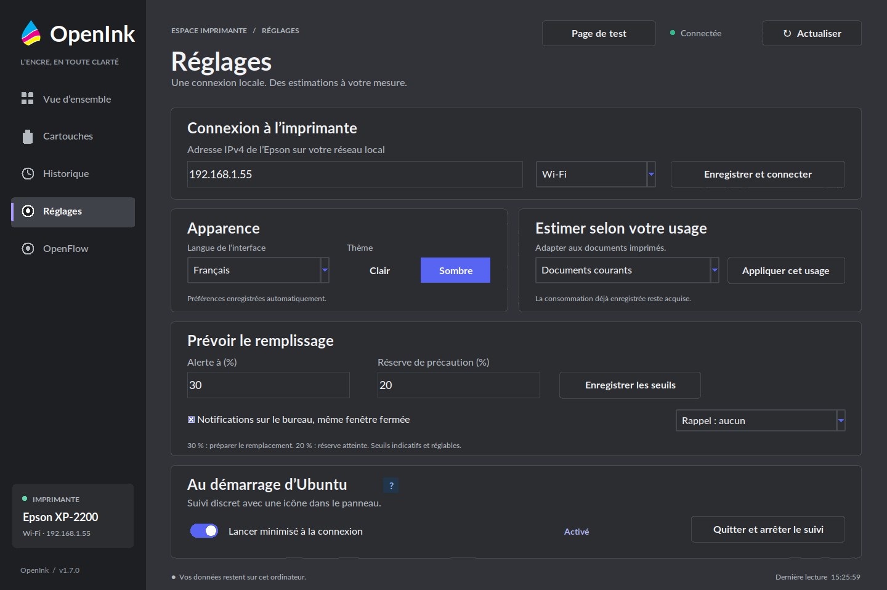
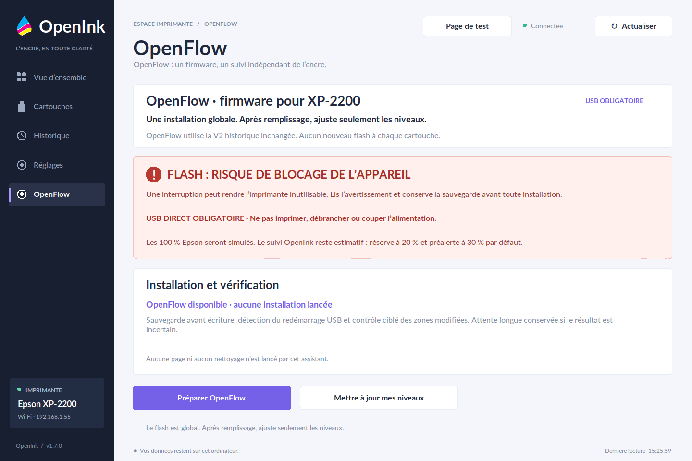

<p align="center">
  
</p>

<h1 align="center">OpenInk · Linux</h1>

<p align="center"><strong>Français</strong> · <a href="README.en.md">English</a> · <a href="README.es.md">Español</a></p>

<p align="center">Suivi indicatif de l’encre et notifications Ubuntu pour Epson XP-2200.</p>

<p align="center">
  
  
  
  
</p>

**OpenInk permet d’installer OpenFlow sur une Epson XP-2200, puis de suivre
l’encre restante avec des estimations et des notifications Ubuntu.**

Le firmware d’origine peut refuser une cartouche compatible et bloquer
l’impression. Le **flash d’OpenFlow par USB** modifie ce comportement global :
sur la XP-2200 IU05P2 testée, il a permis d’imprimer avec des cartouches
compatibles auparavant rejetées ou signalées comme non reconnues.
Il ne réécrit pas leurs puces et ne rend pas utilisable n’importe quelle
référence de cartouche : les cartouches sans puce et tous les modèles tiers
ne sont pas validés.

Une fois OpenFlow installé, les valeurs Epson à 100 % sont simulées. OpenInk
maintient donc un **suivi indépendant par couleur**, fondé sur les compteurs
de pages et le niveau de départ déclaré. Il avertit avant la réserve pour
anticiper le remplissage, sans pouvoir mesurer physiquement l’encre ni
garantir l’absence de désamorçage. Un nouveau flash à chaque cartouche est inutile.


*Captures de l’interface française avec des valeurs d’exemple, sans données personnelles.*

Ce dépôt contient la version **Linux uniquement** : sources, tests, ressources
graphiques et scripts de construction. Il ne contient ni données utilisateur,
ni sauvegarde privée d’imprimante, ni outil Windows/macOS, ni firmware de
récupération ou prototype expérimental. La bibliothèque USB tierce est
conservée avec ses fichiers et sa licence d’origine.

> **Cible limitée à l’Epson XP-2200 / IU05P2.** Le flash peut
> rendre l’appareil inutilisable. Le suivi de l’encre est une estimation :
> il ne mesure pas le volume et ne garantit pas l’absence de désamorçage.

## Fonctionnalités

| Fonction | Comportement |
| --- | --- |
| Vue d’ensemble | Connexion, état, pages couleur et monochromes, activité |
| Cartouches | Diagnostic des états signalés et estimation indépendante par couleur |
| Profils | 604 standard, 604XL ou rendement personnalisé |
| Alertes | Préalerte à 30 %, réserve à 20 %, seuils réglables et notifications Ubuntu |
| Suivi continu | Agent de session utilisable fenêtre fermée et au démarrage de session |
| Historique | Données locales SQLite et export JSON |
| Page de test | PDF A4 avec logo OpenInk, aplats CMJN, intensités, textes et traits fins |
| Firmware OpenFlow | Assistant USB, sauvegarde préalable, intégrité vérifiée, acceptation explicite |
| Interface | Thèmes clair/sombre, logo vectoriel, pourcentages et fenêtre adaptée au moniteur |
| Langues | Français, anglais et espagnol ; choix dans Réglages et détection du système |

## Prérequis

- Ubuntu avec session graphique, cible de paquet **x86_64 / amd64**.
- Python **3.10 ou supérieur**, Tkinter, Pillow, PyGObject/GLib.
- libusb, CUPS, systemd, xdg-utils et XRandR.
- Epson XP-2200 pour les fonctions matérielles. Le suivi accepte USB ou réseau
  local ; le flash exige une connexion USB directe.
- Une file CUPS Epson configurée pour imprimer la page de test.

Le paquet déclare ses dépendances. Pour travailler depuis les sources :

```bash
sudo apt update
sudo apt install python3 python3-tk python3-pil python3-gi gir1.2-glib-2.0 \
  libusb-1.0-0 cups-client systemd xdg-utils x11-xserver-utils
```

## Installation

### Télécharger le paquet prêt à installer

La [version v1.7.0](https://github.com/Chrisnox-209/OpenInk/releases/tag/v1.7.0)
propose le paquet Ubuntu **amd64**, l’archive des sources et `SHA256SUMS`.

Télécharger `openink_1.7.0_amd64.deb` et `SHA256SUMS` dans le même dossier,
fermer l’ancienne application, puis ouvrir un terminal dans ce dossier :

```bash
sha256sum --ignore-missing -c SHA256SUMS
sudo apt install ./openink_1.7.0_amd64.deb
openink
```

Poursuivre seulement si le contrôle du paquet affiche `OK`. `--ignore-missing`
permet de vérifier le paquet même si l’archive des sources n’a pas été téléchargée.
Le téléchargement et l’installation du logiciel ne lancent aucun flash.

### Construire et installer le paquet Ubuntu

```bash
git clone https://github.com/Chrisnox-209/OpenInk.git
cd OpenInk
sudo apt install dpkg-dev desktop-file-utils
python3 linux/build_deb.py
sudo apt install ./linux/dist/openink_1.7.0_amd64.deb
openink
```

Les paquets générés restent dans `linux/dist/`, hors de Git. L’empreinte SHA-256 du `.deb`
est écrite à côté du fichier.

L’installation ajoute le lanceur **OpenInk**, les notifications de session,
le démarrage automatique et une règle d’accès USB limitée à la XP-2200 normale
(`04b8:11b1`). L’usage quotidien se fait **sans sudo**.

Les données existantes sont conservées. Mettre à jour l’application ne déclenche aucun flash.
Une V2 déjà installée n’a pas à être reflashée pour cette mise à jour.

### Mode icône et démarrage automatique

OpenInk démarre à la connexion **sans ouvrir de fenêtre**, avec une icône dans
le panneau Ubuntu et l’agent de suivi actif. Un clic ou le menu **Ouvrir OpenInk**
affiche la fenêtre. La fermer conserve l’icône, le suivi et les notifications.
Le menu indique l’état et les compteurs, propose une actualisation et permet
de **Quitter et arrêter le suivi**. Ce dernier choix arrête les processus de
session, sans interrompre un contrôleur de flash.

Dans **Réglages > Au démarrage d’Ubuntu**, l’interrupteur **Lancer minimisé à la connexion** active ou désactive le lancement automatique avec l’icône. Le bouton **? bleu** explique le suivi en arrière-plan. Le choix s’applique aux prochaines connexions et ne coupe pas le suivi en cours.
L’indicateur utilise le protocole StatusNotifierItem. Sous GNOME, le panneau
doit prendre en charge les indicateurs d’application ; Ubuntu fournit
habituellement cette intégration. Si le panneau ne l’affiche pas, le suivi
continue et la commande `openink` ouvre toujours la fenêtre.

### Lancer sans installer

Depuis la racine du dépôt :

```bash
./linux/Lancer-OpenInk.sh
```

Une adresse réseau peut être précisée au lancement ou dans Réglages :

```bash
./linux/Lancer-OpenInk.sh --host 192.168.1.100 --transport network
./linux/Lancer-OpenInk.sh --transport usb
```

L’adresse ci-dessus est un exemple à remplacer. L’installation du paquet est
recommandée pour les règles USB et l’intégration à la session Ubuntu.
`python3 linux/installer_raccourci.py` crée seulement un raccourci utilisateur
vers ce clone ; il n’installe ni dépendances ni règle USB.

### Commandes utiles après installation

```bash
openink --background    # Surveillance sans fenêtre, selon le réglage d’autostart
openink --stop-agent    # Arrêter la surveillance
openink --help          # Toutes les options
```

## Langue et apparence

Le français reste la version principale de ce README. Les guides
[anglais](README.en.md) et [espagnol](README.es.md) décrivent les mêmes fonctions.

Dans **Réglages > Apparence > Langue de l’interface**, choisir **Français**, **English**,
**Español** ou **Automatique**. Le choix est enregistré et l’interface se met
à jour immédiatement. Le menu du panneau et les notifications suivent cette
préférence ; les historiques et les compteurs restent conservés.

```bash
openink --lang fr
openink --lang en
openink --lang es
```


Le même encart **Apparence** permet de choisir **Clair** ou **Sombre**. Le thème sombre utilise des gris anthracite inspirés de Discord et s’applique aux cinq vues, menus, champs et dialogues. Le choix est immédiat et conservé au prochain lancement.



## Premier lancement et suivi de l’encre

1. Dans **Réglages**, choisir la connexion à la bonne imprimante.
2. Dans **Cartouches**, initialiser chaque couleur avec son profil et un niveau
   réellement estimé. Une cartouche déjà utilisée ne doit pas être déclarée pleine.
3. Après un remplacement ou remplissage réel, ajuster seulement les couleurs
   concernées. Un reset sans ajout d’encre conserve la consommation estimée.
4. Activer les notifications et adapter les seuils à l’usage. Remplir ou
   remplacer avant la réserve si la qualité d’impression baisse.

L’estimation utilise les compteurs de pages et les rendements choisis. Les
photos, la couverture, les nettoyages et les volumes des compatibles peuvent
augmenter fortement la consommation. Les alertes sont **non bloquantes**.
Un recul des compteurs invalide l’estimation et demande une révision.

L’agent peut notifier quand la fenêtre est fermée. L’ordinateur et la session
doivent rester actifs ; une session fermée ou un ordinateur éteint ne peuvent
pas recevoir d’alertes. OpenInk ne pilote pas les voyants de l’imprimante.

## OpenFlow, cartouches et « reset » : portée exacte

**OpenFlow (image V2 historique inchangée) modifie globalement le comportement des quatre couleurs. Ce n’est pas un
reset sélectif des puces.** La sélection de couleurs dans l’assistant sert à
déclarer le niveau dans OpenInk, pas à choisir une portion du firmware à flasher.

- Les niveaux Epson à 100 % sous V2 sont simulés ; la réserve utile est celle
  estimée par OpenInk.
- V2 a permis l’impression avec les compatibles testées. Cela ne prouve pas
  que toutes les cartouches fonctionneront, ni que les puces peuvent être retirées.
- Un diagnostic distingue les états signalés par l’imprimante ; il ne permet
  pas de mesurer physiquement l’encre ou de certifier une puce défectueuse.
- Aucun reset de tampon d’entretien, flash Wi-Fi ou image arbitraire n’est proposé.

Après installation de V2, ajuster le suivi après chaque remplissage suffit :
**un nouveau flash à chaque cartouche est inutile**.

## Assistant OpenFlow et risques



Avant toute écriture, l’assistant impose une confirmation générale, une case
d’acceptation des risques et une confirmation USB, toutes explicites. Il
contrôle le modèle, l’identité, l’image, la version, la disponibilité et les
files d’impression, puis effectue une sauvegarde complète avant transfert.

Le flash comporte un risque de blocage ou de dommage. Le logiciel est fourni
sans garantie ; le texte d’acceptation limite la responsabilité dans les
limites permises par la loi. Cette acceptation ne garantit pas la réussite.

**Laisser l’alimentation et le câble USB branchés, ne pas imprimer et ne pas
mettre l’ordinateur en veille pendant l’opération.** Fermer la fenêtre n’annule
pas le travail en cours. Ne pas mettre à jour ou désinstaller OpenInk pendant
un flash. MFP-IPL, une identité inconnue et une image différente sont refusés.

Le parcours affiche la progression par étape. Après un acquittement exact et
un nouveau périphérique USB normal stable au port vérifié, un contrôle ciblé
lit l’ensemble des secteurs modifiés et les éléments de démarrage attendus.
Si la réponse ou le redémarrage reste incertain, une attente prudente jusqu’à
quinze minutes et une vérification complète sont conservées. Aucun transfert
n’est recommencé automatiquement. Une vérification complète facultative reste
disponible après succès ciblé ; la sauvegarde préalable reste nécessaire.

Voir [le périmètre V2 et les conditions de reprise](docs/PERIMETRE_V2.md).

## Page de test couleur

Cliquer sur **Page de test**, choisir la file Epson, puis **Voir la page** ou
**Imprimer une page**. Si l’identité de la destination n’est pas confirmable,
une confirmation supplémentaire est demandée. Une seule copie A4 couleur,
recto seul, est envoyée après clic explicite.

Le dialogue distingue les files désactivées, privilégie une file disponible
et demande une confirmation quand son identité ne peut pas être établie.
L’état est relu au clic pour éviter de dépendre d’une observation ancienne.
L’envoi reste refusé pendant une opération firmware, si l’imprimante
n’est pas prête ou si la file est occupée. Aucun travail existant n’est
supprimé. Une acceptation par CUPS ne prouve pas encore une sortie papier.
Le PDF se trouve dans [les ressources](commun/inkora/assets/test-page.pdf) ;
ce contrôle visuel ne remplace pas le test des buses Epson.

## Données, confidentialité et désinstallation

Les données restent sur cet ordinateur :

| Donnée | Chemin par défaut |
| --- | --- |
| Base et suivi | `~/.local/share/inkora/inkora.sqlite3` |
| Journaux et sauvegardes firmware | `~/.local/share/inkora/firmware/` |
| Communication locale de l’agent | Répertoire de session utilisateur XDG |

Les emplacements suivent les variables XDG lorsqu’elles sont définies.
Le module Python s’appelle encore `inkora` par compatibilité. Aucun envoi
automatique des données à un tiers n’est prévu. Les historiques, exports,
sauvegardes et numéros de série réels n’ont pas leur place dans Git.

```bash
openink --stop-agent
sudo apt remove openink
```

La désinstallation du logiciel conserve les données et ne restaure pas le
firmware de l’imprimante. Garder les sauvegardes firmware en lieu sûr.

## Architecture du dépôt

```text
commun/inkora/             Application, agent, base, UI et accès matériels
  assets/                 Logo SVG, icônes PNG et page de test PDF
  locales/                Catalogues anglais et espagnol
  firmware_assets/        OpenFlow : image V2 inchangée et manifeste épinglé
  _vendor/                Bibliothèque USB, provenance et licence MIT
linux/                    Lanceurs et scripts de construction Ubuntu
  tests/                  Tests et contrôles graphiques isolés
docs/                     Installation technique, V2 et bilan de validation
CONTRIBUTING.md           Vérifications et conventions de commit
THIRD_PARTY_NOTICES.md    Origine et licences des composants embarqués
```

## Développement et vérifications

```bash
# Tests hors ligne : ne commandent pas l’imprimante
PYTHONDONTWRITEBYTECODE=1 PYTHONWARNINGS=error::ResourceWarning \
  python3 -m unittest discover -s linux/tests -v

# Contrôles graphiques isolés ; nécessitent un affichage
python3 linux/tests/check_interface.py
python3 linux/tests/check_i18n.py
python3 linux/tests/check_appearance.py
dbus-run-session -- python3 linux/tests/check_tray.py

# Construction sans installation ni accès matériel
python3 linux/build_deb.py
python3 linux/build_linux.py
```

Les tests hors ligne couvrent le suivi, les réserves, les migrations, les notifications,
les dialogues, les soumissions CUPS simulées et les limites du contrôleur firmware.
Ils ne remplacent pas une validation physique sur chaque appareil.

Les icônes et le PDF sont déjà fournis. Pour les régénérer seulement :

```bash
sudo apt install python3-reportlab poppler-utils fonts-lato
python3 linux/build_brand_assets.py
```

L’image OpenFlow (V2) est fournie et contrôlée à l’import/construction ; ce dépôt ne contient
pas les outils de recherche historiques nécessaires à sa reconstruction.
Voir [la validation et les limites](docs/OPENINK_1.7.md),
[l’architecture](docs/ARCHITECTURE.md) et les
[conventions de contribution](CONTRIBUTING.md).

## Dépannage

| Symptôme | Vérification |
| --- | --- |
| Imprimante hors ligne | Vérifier l’adresse dans Réglages, l’alimentation et le transport sélectionné |
| Accès USB refusé | Installer le paquet, reconnecter hors flash, vérifier les droits de session et l’absence d’un autre logiciel sur le port |
| Notification absente | Vérifier le suivi, les réglages Ubuntu/Ne pas déranger et la session active |
| Niveau inconnu | Initialiser le suivi pour cette couleur avec une estimation prudente |
| Epson indique 100 % sous V2 | Utiliser les niveaux indicatifs OpenInk, pas les valeurs simulées |
| Page de test refusée | Vérifier la file CUPS choisie, l’état récent et l’absence d’opération firmware |
| Opération firmware interrompue | Conserver journaux/sauvegardes et suivre la vérification proposée, sans relancer un flash à l’aveugle |

## Notices

Projet indépendant, sans affiliation avec Epson. Les noms et marques restent
ceux de leurs titulaires. La licence MIT de `epson-usb` et sa provenance sont
conservées : voir [THIRD_PARTY_NOTICES.md](THIRD_PARTY_NOTICES.md). Aucune licence
globale ne réattribue les droits sur le firmware constructeur embarqué.
